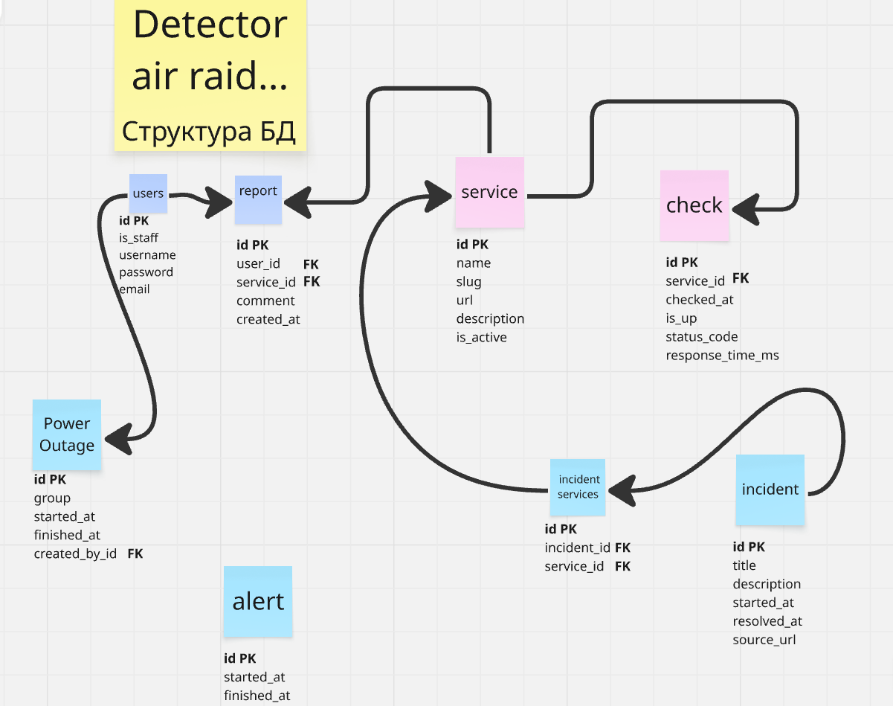

# Detector Air Raid


> Як працюють **Дія**, **Укрзалізниця**, **monobank** і **Приват24** під час
> повітряних тривог і відключень світла в Києві. А саме - чи залежить відповідь цих
> сервісів від тривог, відключень чи інших атак. Можливо знайдемо слабкі години, які не залежать
> від згаданих факторів, а кастомна якась проблема.

## Зміст

- [Ідея](#-ідея)
- [REST API](#-rest-api)
  - [Об'єкти у відповідях](#обєкти-у-відповідях)
  - [Ендпоінти](#ендпоінти)
- [Схема бази даних](#-схема-бази-даних)
- [Запуск](#-запуск)

---

##  Ідея

Сервер кожні 5 хвилин перевіряє, чи відповідають сервіси і як швидко. На сайті можна
побачити:

- чи працює сервіс **зараз** і яка його доступність за день, тиждень, місяць;
- у **які години** найчастіше бувають збої;
- чи працює сервіс **гірше під час тривог**, ніж без них;
- коли в Києві були **тривоги та відключення світла**;
- відомі **інциденти** (збої з новин).

**Ролі:**

| Роль | Що може |
| --- | --- |
| 👀 Гість | Переглядати сервіси, статистику, тривоги, відключення та інциденти |
| 👤 Користувач | Усе, що гість, а також поскаржитися "у мене не працює" і бачити історію своїх скарг |
| 🛠️ Адмін | Додавати, редагувати й видаляти сервіси, відключення світла та інциденти |

**Звідки дані:** тривоги беремо з API [alerts.in.ua](https://alerts.in.ua/), а
відключення світла вносить адмін за графіками (відкритого API немає), а також оброблюючи скарги
користувачів.

---

## REST API

- Базова адреса: `/api/v1/`, дані у форматі JSON.
- Для входу передаємо токен у заголовку: `Authorization: token <token>`.
- Доступ: **усі**, **користувач** (потрібен вхід), **адмін** (`is_staff = true`).
- Довгі списки повертаються сторінками по 20 (`?page=2`) у форматі
  `{"count": 57, "next": "...", "previous": null, "results": [...]}`.
- Загальні помилки: `400` (некоректні дані), `401` (немає токена), `403` (немає прав),
  `404` (не знайдено). Тіло помилки: `{"detail": "..."}` або `{"field": ["..."]}`.

### Об'єкти у відповідях

**Service**

```json
{
  "id": 1,
  "name": "Дія",
  "slug": "diia",
  "url": "https://diia.gov.ua",
  "description": "Портал державних послуг",
  "is_active": true,
  "status": "up",
  "response_time_ms": 340,
  "uptime_7d": 99.42,
  "last_checked_at": "2026-10-27T14:05:00+02:00"
}
```

`status`: `up`, `down` або `unknown`.

**Check**: `{"checked_at": "2026-10-27T14:05:00+02:00", "is_up": true, "status_code": 200, "response_time_ms": 340}`

**Alert**: `{"id": 812, "started_at": "2026-10-27T03:12:00+02:00", "finished_at": "2026-10-27T04:40:00+02:00"}`

**Outage**: `{"id": 55, "group": "3.1", "started_at": "2026-10-27T12:00:00+02:00", "finished_at": "2026-10-27T15:30:00+02:00"}`

**Incident**

```json
{
  "id": 4,
  "title": "Збій платежів",
  "description": "Не проходять оплати карткою.",
  "started_at": "2026-10-20T09:15:00+02:00",
  "resolved_at": null,
  "source_url": "https://example.com/news/456",
  "services": ["monobank", "privat24"]
}
```

**Report**: `{"id": 31, "service": "privat24", "comment": "Не завантажується", "created_at": "2026-10-27T13:58:00+02:00"}`

### Ендпоінти

#### Автентифікація та профіль

| Метод і шлях | Для чого | Доступ | Запит | Відповідь |
| --- | --- | --- | --- | --- |
| `POST /auth/register/` | Реєстрація | усі | `{"username", "email", "password"}` | `201` `{"id", "username", "email", "token"}` |
| `POST /auth/login/` | Вхід | усі | `{"username", "password"}` | `200` `{"token", "user": {"id", "username", "is_staff"}}` |
| `POST /auth/logout/` | Вихід | користувач | — | `204` |
| `GET /profile/` | Мій профіль | користувач | — | `200` `{"id", "username", "email", "date_joined"}` |
| `PATCH /profile/` | Змінити email | користувач | `{"email"}` | `200` профіль |

#### Сервіси

| Метод і шлях | Для чого | Доступ | Запит | Відповідь |
| --- | --- | --- | --- | --- |
| `GET /services/` | Список сервісів | усі | `?status=up\|down` `?ordering=uptime_7d\|response_time` | `200` масив Service |
| `GET /services/{slug}/` | Сторінка сервісу | усі | — | `200` Service + `"uptime": {"24h", "7d", "30d"}`, `"reports_last_hour"`; `404` |
| `POST /services/` | Додати сервіс | адмін | `{"name", "slug", "url", "description", "is_active"}` | `201` Service; `400` |
| `PATCH /services/{slug}/` | Редагувати сервіс | адмін | будь-які поля з POST | `200` Service; `400`, `404` |
| `DELETE /services/{slug}/` | Видалити сервіс | адмін | — | `204`; `404` |
| `GET /services/{slug}/checks/` | Історія перевірок для графіка | усі | `?from=` `?to=` (дата) `?page=` | `200` сторінка Check; `404` |
| `GET /services/{slug}/stats/` | Статистика | усі | `?period=24h\|7d\|30d` | `200` див. нижче; `404` |

Відповідь `GET /services/{slug}/stats/`:

```json
{
  "period": "7d",
  "uptime_percent": 99.42,
  "avg_response_time_ms": 371,
  "by_hour": [{"hour": 0, "uptime_percent": 100.0, "avg_response_time_ms": 310}],
  "during_alerts": {"uptime_percent": 97.2, "avg_response_time_ms": 512},
  "without_alerts": {"uptime_percent": 99.7, "avg_response_time_ms": 354}
}
```

#### Тривоги та відключення світла

| Метод і шлях | Для чого | Доступ | Запит | Відповідь |
| --- | --- | --- | --- | --- |
| `GET /alerts/` | Історія тривог у Києві | усі | `?active=true` `?from=` `?to=` `?page=` | `200` сторінка Alert |
| `GET /outages/` | Історія відключень | усі | `?group=3.1` `?active=true` `?from=` `?to=` `?page=` | `200` сторінка Outage |
| `POST /outages/` | Додати відключення | адмін | `{"group", "started_at", "finished_at"}` | `201` Outage; `400` |
| `PATCH /outages/{id}/` | Редагувати відключення | адмін | будь-які поля з POST | `200` Outage; `400`, `404` |
| `DELETE /outages/{id}/` | Видалити відключення | адмін | — | `204`; `404` |

> [!NOTE]
> Тривоги через API тільки читаються: їх записує фоновий процес (TODO).

> [!IMPORTANT]
> **Захист від дублікатів відключень.** `POST` і `PATCH /outages/` повертають `400`, якщо:
> 1. для цієї групи вже є відключення з таким самим `started_at` (унікальна пара
>    `group` + `started_at` у базі даних);
> 2. для цієї групи вже є відключення, яке **перетинається в часі** з новим
>    (перевірка під час валідації).
>
> Приклад відповіді: `{"non_field_errors": ["Для групи 3.1 у цей час уже є відключення."]}`

#### Інциденти

| Метод і шлях | Для чого | Доступ | Запит | Відповідь |
| --- | --- | --- | --- | --- |
| `GET /incidents/` | Список інцидентів | усі | `?service=diia` `?active=true` `?search=` `?page=` | `200` сторінка Incident |
| `GET /incidents/{id}/` | Один інцидент | усі | — | `200` Incident; `404` |
| `POST /incidents/` | Додати інцидент | адмін | `{"title", "description", "started_at", "resolved_at", "source_url", "services"}` | `201` Incident; `400` |
| `PATCH /incidents/{id}/` | Редагувати інцидент | адмін | будь-які поля з POST | `200` Incident; `400`, `404` |
| `DELETE /incidents/{id}/` | Видалити інцидент | адмін | — | `204`; `404` |

#### Скарги

| Метод і шлях | Для чого | Доступ | Запит | Відповідь |
| --- | --- | --- | --- | --- |
| `GET /reports/` | Мої скарги | користувач | `?page=` | `200` сторінка Report |
| `POST /reports/` | Поскаржитися «у мене не працює» | користувач | `{"service": "privat24", "comment": "..."}` | `201` Report; `400` |

---

## 🗄️ Схема бази даних



---

## Запуск

```bash
python -m venv .venv
.venv\Scripts\activate        # Windows; на Linux/macOS: source .venv/bin/activate
python -m pip install -r requirements-dev.txt
python manage.py migrate
python manage.py runserver
```

Перевірка стилю коду: `python check_submission.py`
